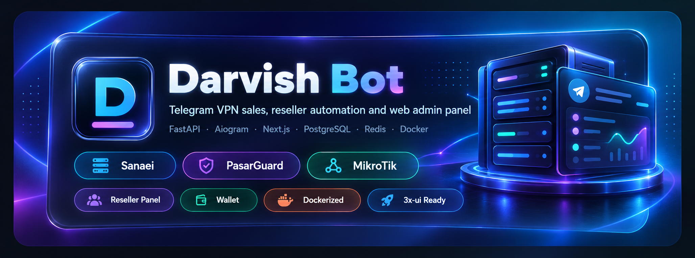
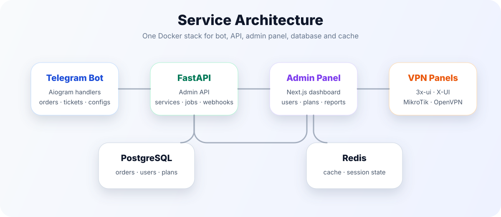

<p align="center"></p>
<h1 align="center">D BOT</h1>
<p align="center"><b>فروشگاه VPN شما؛ مشتریان شما؛ یک پلتفرم یکپارچه.</b></p>
<p align="center"><a href="README.md">🇬🇧 English</a> · <a href="README_FA.md">🇮🇷 فارسی</a></p>

<p align="center">
  
  
  
  
</p>

<p align="center"></p>

<p align="center">
  <a href="#features">قابلیت‌ها</a> ·
  <a href="#install">نصب سریع</a> ·
  <a href="https://youtu.be/g2625m5gqBc">تماشای معرفی</a> ·
  <a href="https://www.youtube.com/@officialdarvish">YouTube</a>
</p>

**از اولین خرید تا تمدید بعدی، فروش و مدیریت سرویس‌ها را یک‌جا انجام دهید.** D BOT ربات فروش تلگرام، مینی‌اپ مشتریان و سیستم نمایندگی را به یک وب‌پنل مدیریتی متصل می‌کند.

<table>
  <tr>
    <td width="33%" align="center" valign="top"><h3>🤖<br>ربات تلگرام</h3><p>فروش اشتراک، تحویل کانفیگ و ارتباط با مشتریان در تلگرام.</p></td>
    <td width="33%" align="center" valign="top"><h3>📱<br>مینی‌اپ مدرن</h3><p>خرید، پرداخت، اکانت تست، پیگیری سفارش و مدیریت سرویس داخل تلگرام.</p></td>
    <td width="33%" align="center" valign="top"><h3>🖥️<br>وب‌پنل اختصاصی</h3><p>مدیریت سرورها، پلن‌ها، کاربران، پرداخت‌ها و گزارش‌ها به فارسی و انگلیسی.</p></td>
  </tr>
</table>

<a id="features"></a>

## ✨ همراه کارهای روزانه شما

| قابلیت | امکانات |
| --- | --- |
| 💱 قیمت‌گذاری منعطف | قیمت‌گذاری ریالی با واحد تومان یا دلاری با تبدیل خودکار بر اساس نرخ ارز تنظیم‌شده. |
| 💳 پرداخت و کیف پول | رسید کارت‌به‌کارت، تأیید پرداخت، خرید از کیف پول و شارژ موجودی؛ NOWPayments به‌صورت اختیاری. |
| 🎫 پشتیبانی و تعامل | تیکت و پاسخ‌گویی، ارتباط مستقیم، قوانین و راهنمای برنامه‌ها همراه ویدیوی آموزشی. |
| 🏷️ تخفیف‌ها | کد تخفیف مبلغی یا درصدی، محدودیت استفاده و دامنه پلن یا سرور. |
| 🔔 اطلاع‌رسانی | وضعیت خرید و پرداخت، هشدار زمان و حجم سرویس و اعلان‌های مدیریتی. |
| 🎨 شخصی‌سازی | ویرایش دکمه‌ها و متن‌های ربات، ظاهر و میان‌برهای مینی‌اپ. |
| 🔌 اتصال تلگرام | اتصال مستقیم، HTTP/SOCKS، MikroTik SOCKS یا V2/Xray؛ مناسب مسیر اتصال تلگرام روی VPS ایران. |
| 📊 گزارش‌های مالی | گزارش فروش و سفارش‌ها، تاریخچه صورتحساب نمایندگان و PDF دوره‌ای فروش. |
| 🧰 بکاپ متناسب با نیاز شما | بکاپ دستی یا زمان‌بندی‌شده دیتابیس، آرشیو کامل پروژه و بازیابی روی نصب دیگر. |


### 🤝 سه مدل برای توسعه فروش نمایندگی

<table>
  <tr>
    <td width="33%" align="center" valign="top"><h3>📦<br>فروش حجم</h3><p>بسته‌های حجمی پیش‌پرداخت و مدیریت حجم قابل فروش.</p></td>
    <td width="33%" align="center" valign="top"><h3>⚡<br>Pay As You Go</h3><p>محاسبه هزینه بر اساس مصرف، کیف پول و پیگیری استفاده.</p></td>
    <td width="33%" align="center" valign="top"><h3>🌐<br>پنل وب پاسارگارد</h3><p>فروش پنل وب نمایندگی با دسترسی محدود و مشخص.</p></td>
  </tr>
</table>

### 🔗 اتصال به پنل‌های شما

| Sanaei / 3x-ui / X-UI | PasarGuard | MikroTik / OpenVPN |
| :---: | :---: | :---: |
| سرویس‌های Xray | سرویس‌های عمومی و نمایندگی | سرویس‌های روتر و OpenVPN |

پشتیبانی از چند سرور با سیاست اینباند و گروه؛ عملیات در دسترس تابع مجوزهای پنل است.

<a id="install"></a>

## 🚀 از راه‌اندازی تا اولین فروش

روی VPS لینوکسی تازه، دامنه را به سرور متصل و دستور زیر را اجرا کنید:

```bash
bash <(curl -Ls https://raw.githubusercontent.com/officialdarvish/D_bot/main/install.sh)
```

1. **نصب:** دامنه و SSL، مشخصات تلگرام، ورود وب و PostgreSQL را تنظیم کنید.
2. **تکمیل Setup Wizard:** گزینه‌های کانال و قوانین، مشخصات ربات و پشتیبانی، پیام اصلی و مسیر خصوصی وب را مشخص و **Save and complete setup** را بزنید.
3. **شروع فروش:** پنل‌ها را متصل، پلن‌ها را اضافه و مینی‌اپ را از وب‌پنل فعال کنید.

<details>
<summary><b>⌨️ راه‌اندازی و فرمان‌های سریع</b></summary>

با `dbot` یا `dbot menu` مرکز کنترل را باز کنید. شماره گزینه را وارد کنید یا فرمان مستقیم آن را بزنید:

| منو | فرمان | عملکرد |
| --- | --- | --- |
| ۱ / ۲ | `dbot status` / `dbot logs` | وضعیت کانتینرها / لاگ زنده؛ خروج از لاگ با `Ctrl+C` |
| ۳ / ۴ / ۵ | `dbot restart` / `dbot start` / `dbot stop` | مدیریت سرویس‌ها |
| ۶ | `dbot update` | به‌روزرسانی و ساخت مجدد |
| ۷ | `dbot backup` | بکاپ کامل پروژه با حالت حفاظت ذخیره‌شده |
| ۸ / ۹ | — | مشاهده / ویرایش مقادیر راه‌اندازی |
| ۱۰ / ۱۱ | — / `dbot credentials` | Nginx و SSL / مرکز اطلاعات ورود |
| ۱۳ | `dbot backups` | مدیریت بکاپ‌های ذخیره‌شده |
| ۰ | — | خروج از منو |

فرمان `dbot backup-keys` فهرست کلیدهای اختصاصی ثبت‌شده را خروجی می‌دهد. اطلاعات محرمانه را با `umask 077` در محل امن نگهداری کنید.

</details>

## 🔐 حفاظت بکاپ با انتخاب شما

در **Backup & Restore** یا **Settings** حالت را انتخاب و پیش از ساخت بکاپ ذخیره کنید:

| حالت | بازیابی روی VPS جدید |
| --- | --- |
| عادی | بدون رمزنگاری کامل؛ JSON دیتابیس یا آرشیو پروژه قابل خواندن است. |
| کلید اختصاصی | با کلید بازیابی یا فایل `dbot-recovery-keys.json`. هنگام ذخیره، همه کلیدهای بکاپ ثبت‌شده به مقصد تنظیم‌شده ارسال می‌شوند؛ هر بکاپ ارسالی نیز پیام جداگانه فهرست کلیدها دارد. |
| رمز AES | رمزنگاری AES-256-GCM با scrypt؛ رمز زمان ساخت بکاپ کافی است و همراه فایل ارسال نمی‌شود. |

یک نسخه آفلاین از کلیدها و رمزها نگه دارید. دارنده فایل بکاپ و کلیدهای متناظر می‌تواند آن را بازیابی کند. تغییر حفاظت فقط روی فایل‌های جدید اعمال می‌شود. بکاپ دیتابیس `.dbot`/JSON از وب یا ربات و آرشیو کامل پروژه با ابزار بازیابی آرشیو باز می‌شود. [راهنمای بکاپ](docs/ENCRYPTED_BACKUPS_FA.md).

<details>
<summary><b>🐳 سرویس‌های متصل در یک زیرساخت داکر</b></summary>

Python / Aiogram / FastAPI و Next.js، با **PostgreSQL 16** برای داده‌های پایدار و **Redis** برای وضعیت اجرایی و کش. وب‌پنل و مینی‌اپ از بک‌اند مشترک استفاده می‌کنند.

<p align="center"></p>

</details>

## Official Links

| مرجع | لینک |
| --- | --- |
| گیت‌هاب | [officialdarvish/D_bot](https://github.com/officialdarvish/D_bot) |
| کانال تلگرام | [@officialdarvishchannel](https://t.me/officialdarvishchannel) |
| ربات تلگرام | [@officialdarvish_bot](https://t.me/officialdarvish_bot) |
| کانال یوتیوب | [@officialdarvish](https://www.youtube.com/@officialdarvish) |
| معرفی و آموزش نصب | [تماشای آموزش](https://youtu.be/gzTt6hj752A?si=NP7Mwnb17jMunGaH) |
| معرفی D BOT نسخه ۱.۲.۰ | [تماشای ویدیو](https://youtu.be/g2625m5gqBc) |
| حمایت مالی | [NOWPayments](https://nowpayments.io/donation/officialdarvish) |

## Support the Project

با ستاره‌دادن به مخزن، معرفی D BOT، دنبال‌کردن یوتیوب یا [حمایت مالی](https://nowpayments.io/donation/officialdarvish) به توسعه پروژه کمک کنید.

<p align="center"><a href="https://nowpayments.io/donation/officialdarvish"></a></p>

Built with ❤️ by [Darvish](https://github.com/officialdarvish)
