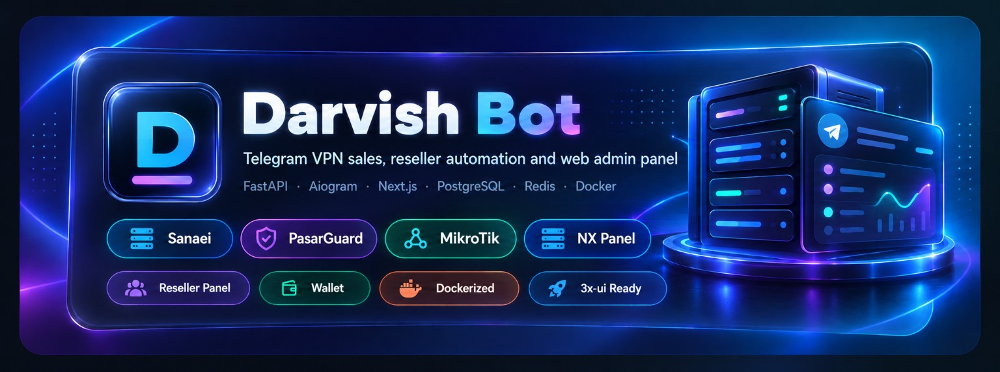
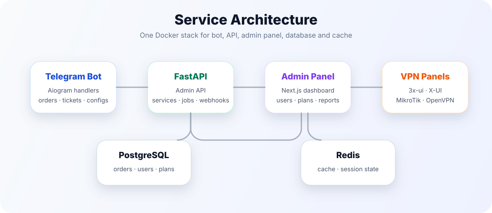

<p align="center"></p>
<h1 align="center">D BOT</h1>
<p align="center"><b>فروشگاه VPN شما؛ مشتریان شما؛ یک پلتفرم یکپارچه.</b></p>
<p align="center"><a href="README.md">🇬🇧 English</a> · <a href="README_FA.md">🇮🇷 فارسی</a></p>

<p align="center">
  
  
  
  
</p>

<p align="center"></p>

<p align="center">
  <a href="#features">قابلیت‌ها</a> ·
  <a href="#install">نصب سریع</a> ·
  <a href="https://youtu.be/g2625m5gqBc">تماشای معرفی</a> ·
  <a href="https://www.youtube.com/@officialdarvish">YouTube</a>
</p>

**از اولین خرید تا تمدید بعدی، فروش و مدیریت سرویس‌ها را یک‌جا انجام دهید.** D BOT ربات فروش تلگرام، مینی‌اپ مشتریان و سیستم نمایندگی را به یک وب‌پنل مدیریتی متصل می‌کند.

<table>
  <tr>
    <td width="33%" align="center" valign="top"><h3>🤖<br>ربات تلگرام</h3><p>فروش اشتراک، تحویل کانفیگ و ارتباط با مشتریان در تلگرام.</p></td>
    <td width="33%" align="center" valign="top"><h3>📱<br>مینی‌اپ مدرن</h3><p>خرید، پرداخت، اکانت تست، پیگیری سفارش و مدیریت سرویس داخل تلگرام.</p></td>
    <td width="33%" align="center" valign="top"><h3>🖥️<br>وب‌پنل اختصاصی</h3><p>مدیریت سرورها، پلن‌ها، کاربران، پرداخت‌ها و گزارش‌ها به فارسی و انگلیسی.</p></td>
  </tr>
</table>

<a id="features"></a>

## ✨ همراه کارهای روزانه شما

| قابلیت | امکانات |
| --- | --- |
| 💱 قیمت‌گذاری منعطف | قیمت‌گذاری ریالی با واحد تومان یا دلاری با تبدیل خودکار بر اساس نرخ ارز تنظیم‌شده. |
| 💳 پرداخت و کیف پول | رسید کارت‌به‌کارت، تأیید پرداخت، خرید از کیف پول و شارژ موجودی؛ NOWPayments به‌صورت اختیاری. |
| 🎫 پشتیبانی و تعامل | تیکت و پاسخ‌گویی، ارتباط مستقیم، قوانین و راهنمای برنامه‌ها همراه ویدیوی آموزشی. |
| 🏷️ تخفیف‌ها | کد تخفیف مبلغی یا درصدی، محدودیت استفاده و دامنه پلن یا سرور. |
| 🔔 اطلاع‌رسانی | وضعیت خرید و پرداخت، هشدار زمان و حجم سرویس و اعلان‌های مدیریتی. |
| 🎨 شخصی‌سازی | ویرایش دکمه‌ها و متن‌های ربات، ظاهر و میان‌برهای مینی‌اپ. |
| 🔌 اتصال تلگرام | اتصال مستقیم، HTTP/SOCKS، MikroTik SOCKS یا V2/Xray؛ مناسب مسیر اتصال تلگرام روی VPS ایران. |
| 📊 گزارش‌های مالی | گزارش فروش و سفارش‌ها، تاریخچه صورتحساب نمایندگان و PDF دوره‌ای فروش. |
| 🧰 بکاپ متناسب با نیاز شما | بکاپ دستی یا زمان‌بندی‌شده دیتابیس، آرشیو کامل پروژه و بازیابی روی نصب دیگر. |


### 🤝 سه مدل برای توسعه فروش نمایندگی

<table>
  <tr>
    <td width="33%" align="center" valign="top"><h3>📦<br>فروش حجم</h3><p>بسته‌های حجمی پیش‌پرداخت و مدیریت حجم قابل فروش.</p></td>
    <td width="33%" align="center" valign="top"><h3>⚡<br>Pay As You Go</h3><p>محاسبه هزینه بر اساس مصرف، کیف پول و پیگیری استفاده.</p></td>
    <td width="33%" align="center" valign="top"><h3>🌐<br>پنل وب پاسارگارد</h3><p>فروش پنل وب نمایندگی با دسترسی محدود و مشخص.</p></td>
  </tr>
</table>

### 🔗 اتصال به پنل‌های شما

| Sanaei / 3x-ui / X-UI | PasarGuard | MikroTik / OpenVPN | NX Panel |
| :---: | :---: | :---: | :---: |
| سرویس‌های Xray | سرویس‌های عمومی و نمایندگی | سرویس‌های روتر و OpenVPN | سرویس‌های عمومی و نمایندگی D BOT |

پشتیبانی از چند سرور با سیاست اینباند و گروه؛ عملیات در دسترس تابع مجوزهای پنل است.

اتصال NX Panel با توکن API و Template برای فروش عمومی و نمایندگی حجمی/PAYG ربات انجام می‌شود. ساخت و تمدید حساب، افزایش حجم و روز، فعال/غیرفعال‌سازی، حذف، آمار مصرف و مدیریت HWID پشتیبانی می‌شوند. دریافت فایل‌های OpenVPN، OpenConnect و WireGuard به ارائه فایل از سوی NX بستگی دارد؛ فروش حساب مدیر NX پشتیبانی نمی‌شود. [راهنمای اتصال NX Panel](docs/NX_PANEL_FA.md).

<a id="install"></a>

## 🚀 از راه‌اندازی تا اولین فروش

روی VPS لینوکسی تازه، دامنه را به سرور متصل و دستور زیر را اجرا کنید:

```bash
bash <(curl -Ls https://raw.githubusercontent.com/officialdarvish/D_bot/main/install.sh)
```

1. **نصب:** دامنه و SSL، مشخصات تلگرام، ورود وب و PostgreSQL را تنظیم کنید.
2. **تکمیل Setup Wizard:** گزینه‌های کانال و قوانین، مشخصات ربات و پشتیبانی، پیام اصلی و مسیر خصوصی وب را مشخص و **Save and complete setup** را بزنید.
3. **شروع فروش:** پنل‌ها را متصل، پلن‌ها را اضافه و مینی‌اپ را از وب‌پنل فعال کنید.

<details>
<summary><b>⌨️ راه‌اندازی و فرمان‌های سریع</b></summary>

با `dbot` یا `dbot menu` مرکز کنترل را باز کنید. شماره گزینه را وارد کنید یا فرمان مستقیم آن را بزنید:

| منو | فرمان | عملکرد |
| --- | --- | --- |
| ۱ / ۲ | `dbot status` / `dbot logs` | وضعیت کانتینرها / لاگ زنده؛ خروج از لاگ با `Ctrl+C` |
| ۳ / ۴ / ۵ | `dbot restart` / `dbot start` / `dbot stop` | مدیریت سرویس‌ها |
| ۶ | `dbot update` | به‌روزرسانی و ساخت مجدد |
| ۷ | `dbot backup` | بکاپ کامل پروژه با حالت حفاظت ذخیره‌شده |
| ۸ / ۹ | — | مشاهده / ویرایش مقادیر راه‌اندازی |
| ۱۰ / ۱۱ | — / `dbot credentials` | Nginx و SSL / مرکز اطلاعات ورود |
| ۱۳ | `dbot backups` | مدیریت بکاپ‌های ذخیره‌شده |
| ۰ | — | خروج از منو |

فرمان `dbot backup-keys` فهرست کلیدهای اختصاصی ثبت‌شده را خروجی می‌دهد. اطلاعات محرمانه را با `umask 077` در محل امن نگهداری کنید.

</details>

## 🔐 حفاظت بکاپ با انتخاب شما

در **Backup & Restore** یا **Settings** حالت را انتخاب و پیش از ساخت بکاپ ذخیره کنید:

| حالت | بازیابی روی VPS جدید |
| --- | --- |
| عادی | بدون رمزنگاری کامل؛ JSON دیتابیس یا آرشیو پروژه قابل خواندن است. |
| کلید اختصاصی | با کلید بازیابی یا فایل `dbot-recovery-keys.json`. هنگام ذخیره، همه کلیدهای بکاپ ثبت‌شده به مقصد تنظیم‌شده ارسال می‌شوند؛ هر بکاپ ارسالی نیز پیام جداگانه فهرست کلیدها دارد. |
| رمز AES | رمزنگاری AES-256-GCM با scrypt؛ رمز زمان ساخت بکاپ کافی است و همراه فایل ارسال نمی‌شود. |

یک نسخه آفلاین از کلیدها و رمزها نگه دارید. دارنده فایل بکاپ و کلیدهای متناظر می‌تواند آن را بازیابی کند. تغییر حفاظت فقط روی فایل‌های جدید اعمال می‌شود. بکاپ دیتابیس `.dbot`/JSON از وب یا ربات و آرشیو کامل پروژه با ابزار بازیابی آرشیو باز می‌شود. [راهنمای بکاپ](docs/ENCRYPTED_BACKUPS_FA.md).

<details>
<summary><b>🐳 سرویس‌های متصل در یک زیرساخت داکر</b></summary>

Python / Aiogram / FastAPI و Next.js، با **PostgreSQL 16** برای داده‌های پایدار و **Redis** برای وضعیت اجرایی و کش. وب‌پنل و مینی‌اپ از بک‌اند مشترک استفاده می‌کنند.

<p align="center"></p>

</details>

اتصال NX Panel مسیر خصوصی وب را چه جداگانه و چه داخل آدرس پنل حفظ می‌کند؛ پسوند API یا ورود نیز برای جلوگیری از تکرار مسیر اصلاح می‌شود. تست، افزودن و ویرایش از همین منطق استفاده می‌کنند. برای خطای 404 قالب‌ها، آدرس وب‌پنل، پورت، مسیر خصوصی و پشتیبانی API نسخه ۱ را مطابق [راهنمای NX](docs/NX_PANEL_FA.md) بررسی کنید.

## WIzard Setup D Bot

نام ویزارد اولیه **WIzard Setup D Bot** است. صفحه‌های آن از فایل‌های استایل مشترک وب‌پنل استفاده می‌کنند؛ فرم‌ها، انتخاب‌ها، نوار پیشرفت و نمایش فارسی/انگلیسی در موبایل و دسکتاپ هماهنگ شده‌اند. فرم‌های تنظیمات داخل مراحل نیز ظاهر استاندارد وب‌پنل را دارند.

ذخیره سرور در ویزارد با پاسخ JSON هماهنگ است؛ درخواست‌های XMLHttpRequest نسخه قبلی نیز پشتیبانی می‌شوند. نشست منقضی یا صفحه غیر JSON خطای خوانا دارد و ذخیره خودکار تکرار نمی‌شود؛ پیش از تلاش مجدد پس از نتیجه نامشخص، فهرست سرورها را بررسی کنید.

تگ‌های نام، شماره و نوع سرور در ستاپ اولیه نمایش داده نمی‌شوند. پس از تأیید و ذخیره موفق، پیام «سرور شما با موفقیت اضافه شد.» در فارسی و پیام انگلیسی متناظر در زبان انگلیسی نمایش داده می‌شود.

رابط همه مراحل ویزارد با استایل مشترک وب‌پنل هماهنگ است: فرم‌ها، کارت‌ها، دکمه‌ها، بازیابی بکاپ و نمایش موبایل یکپارچه‌اند. فهرست واکنش‌گرای مراحل، مرحله جاری و بازگشت به مراحل قبلی را نشان می‌دهد. فرم‌های پنل وضعیت بارگذاری دارند و هنگام ذخیره، کلیک تکراری غیرفعال است. تغییرات ذخیره‌نشده باید پیش از ادامه ثبت شوند؛ جهت صفحه و عنوان فرم‌ها با زبان انتخابی هماهنگ می‌شوند.

بخش عمومی **Settings** در مراحل ستاپ اولیه نمایش داده نمی‌شود و از وب‌پنل اصلی در دسترس است. مراحل تنظیمات داخلی اختیاری‌اند؛ با دکمه **ادامه** می‌توان مقادیر فعلی را حفظ کرد. اگر تغییری دادید، پیش از ادامه آن را ذخیره کنید.

غیرفعال‌بودن قابلیت اختیاری فقط عملیات همان بخش در تلگرام را محدود می‌کند. دستور `/start`، لینک شروع همراه پارامتر و دکمه شروع مجدد، حتی از فرم نیمه‌تمام بخش قبلی به مسیر اصلی ربات می‌رسند. کلید خاموش/روشن عمدی ربات توسط مدیر و بررسی‌های عادی دسترسی مستقل باقی می‌مانند.

## پایداری تنظیمات بکاپ

تشخیص کانال بکاپ و ذخیره تنظیمات مشترک اکنون به‌صورت اتمیک انجام می‌شود تا پیام‌های هم‌زمان تلگرام باعث ثبت کلید تکراری نشوند. کش تنظیمات پس از ذخیره نیز تازه می‌شود؛ نیازی به پاک‌کردن دیتابیس یا تنظیم دستی نیست.

## محدوده استفاده کد تخفیف

در **کدهای تخفیف** هنگام ساخت یا ویرایش کد، دسته‌بندی‌ها و پلن‌های مجاز را به‌صورت چندانتخابی مشخص کنید. خالی‌بودن هر بخش یعنی همه؛ محدودیت‌های انتخاب‌شده سرور، دسته‌بندی و پلن باید هم‌زمان برقرار باشند. اعتبار کد هنگام پرداخت در ربات و مینی‌اپ، برای خرید و تمدید دوباره بررسی می‌شود. کدهای قبلی تا زمان تعیین محدودیت جدید، رفتار قبلی خود را حفظ می‌کنند.

## نصب‌های فعال D BOT

**ارسال آمار ناشناس نصب پس از نصب یا آپدیت، به‌صورت پیش‌فرض فعال است.** ربات هر ۵ دقیقه فقط یک شناسه تصادفی ثابت ۲۵۶ بیتی را با HTTPS به `https://count.botgiftshop.ir/heartbeat` می‌فرستد. سرویس هش SHA-256 شناسه و زمان آخرین فعالیت را ذخیره می‌کند تا مجموع نصب‌های فعال در ۱۵ دقیقه اخیر نمایش داده شود؛ این عدد تعداد افراد، مشتریان یا اتصال‌های VPN نیست. HTTPS محتوای ارتباط را در مسیر رمزنگاری می‌کند؛ مقصد از صاحبان سرور مخفی نیست. شناسه تلگرام، توکن ربات، دامنه، تعداد مشتریان یا نسخه ارسال نمی‌شود. مثل هر ارتباط شبکه، IP مبدا هنگام ارتباط برای سرور قابل مشاهده است؛ سرویس ارائه‌شده آن را در دیتابیس یا لاگ درخواست‌ها ذخیره نمی‌کند.

نصب‌های استانداردی که قبلاً تنظیمات شمارنده نداشته‌اند، با آپدیت و راه‌اندازی مجدد خودکار متصل می‌شوند. آدرس خالی قدیمی از دامنه مرکزی استفاده می‌کند. **مقدار صریح `DBOT_COUNTER_ENABLED=false` حفظ می‌شود**؛ حتی اگر از نسخه قدیمی باقی مانده باشد، برای مشارکت باید با انتخاب صاحب نصب به `true` تغییر کند. آدرس HTTPS سفارشی هم حفظ می‌شود. دکمه خاموش‌کردن در وب‌پنل وجود ندارد. برای انصراف روی VPS، مقدار `DBOT_COUNTER_ENABLED=false` را در `.env` تنظیم و کانتینرهای API و bot را دوباره ایجاد کنید. اختلال شمارنده عملکرد ربات را متوقف نمی‌کند و نصب قطع‌شده پس از ۱۵ دقیقه از آمار فعال خارج می‌شود. [راهنمای شمارنده و محدودیت‌ها](integrations/installation_counter/README.md).

## Official Links

| مرجع | لینک |
| --- | --- |
| گیت‌هاب | [officialdarvish/D_bot](https://github.com/officialdarvish/D_bot) |
| کانال تلگرام | [@officialdarvishchannel](https://t.me/officialdarvishchannel) |
| ربات تلگرام | [@officialdarvish_bot](https://t.me/officialdarvish_bot) |
| کانال یوتیوب | [@officialdarvish](https://www.youtube.com/@officialdarvish) |
| معرفی و آموزش نصب | [تماشای آموزش](https://youtu.be/gzTt6hj752A?si=NP7Mwnb17jMunGaH) |
| معرفی D BOT نسخه ۱.۲.۰ | [تماشای ویدیو](https://youtu.be/g2625m5gqBc) |
| حمایت مالی | [NOWPayments](https://nowpayments.io/donation/officialdarvish) |

## Support the Project

با ستاره‌دادن به مخزن، معرفی D BOT، دنبال‌کردن یوتیوب یا [حمایت مالی](https://nowpayments.io/donation/officialdarvish) به توسعه پروژه کمک کنید.

<p align="center"><a href="https://nowpayments.io/donation/officialdarvish"></a></p>

Built with ❤️ by [Darvish](https://github.com/officialdarvish)


## نسخه 1.4.0 — راه‌اندازی و اتصال‌ها

در این شاخه آپدیت وب با فایل نسخه، ویزارد قابل ادامه فارسی/انگلیسی، اتصال مشترک فروش عمومی/نمایندگی، مدیریت NX و پرداخت Darvish Bridge اضافه شده‌اند. این نسخه با درخواست نگهدارنده به شماره 1.4.0 منتشر می‌شود؛ تست زنده VPS، PostgreSQL و سرویس‌ها همچنان انجام نشده است. [وضعیت](docs/WEB_SETUP_UPDATE_STATUS_FA.md)، [NX](docs/NX_PANEL_FA.md)، [تنظیم بریج](docs/DARVISH_BRIDGE_CONNECTION_FA.md)، [سیاست مهاجرت](docs/SERVER_CONNECTION_MIGRATION_FA.md) و [نتیجه تست‌ها](docs/VALIDATION_WEB_SETUP.md) را ببینید.

در **Payments ← + افزودن روش پرداخت** گزینه **Darvish Bridge** را برای تنظیم آدرس HTTPS، ربات، ارز و کلیدها انتخاب کنید. اتصال ذخیره‌شده از کارت خودش در Payments ویرایش می‌شود. کارت Version وضعیت اتصال اجراکننده VPS را نشان می‌دهد. در نصب‌های قدیمی، یک‌بار `sudo dbot update` اجرا کنید تا اجراکننده systemd نصب یا ترمیم شود؛ تأییدهای بعدی داخل وب، بکاپ، ساخت و راه‌اندازی را روی همان VPS اجرا می‌کنند. [راهنمای آپدیت وب](docs/WEB_SETUP_UPDATE_STATUS_FA.md).

بیلد ۵ کپی تکراری تاریخچه منو را حذف می‌کند، ویدیو را از فایل موقت می‌فرستد، لایه‌های QR را زودتر آزاد می‌کند و یک ایمیج مشترک می‌سازد. بازیابی آپدیت از ایمیج سالم قبلی، بدون بیلد مجدد انجام می‌شود و مرحله شکست نمایش داده می‌شود. برای آمار واقعی میزبان و کانتینرها، بعد از آپدیت `sudo dbot memory` را اجرا کنید. تنظیمات صریح pool در .env حفظ می‌شوند. [گزارش حافظه و بازیابی](docs/MEMORY_UPDATE_RECOVERY_FA.md).

بیلد ۷: سوابق Users → List، فرم شرطی پلن عمومی/نمایندگی، انتقال پیام خانه به Custom، سرچ فقط کاربران/نمایندگان، کارت‌های کوچک‌تر داشبورد، حفظ رسیدها و پاک‌سازی امن هر ۴۵ روز. برای گزارش دیسک `sudo dbot disk` را اجرا کنید. [توضیحات بیلد](docs/MAINTENANCE_AND_HISTORY_BUILD7.md) و [راه‌اندازی اختیاری شمارنده ناشناس نصب](integrations/installation_counter/README.md)؛ نمایش تعداد سراسری به سرویس HTTPS پیکربندی‌شده نیاز دارد.

بیلد ۱۰: پرداخت جدید Darvish Bridge فقط **تومان (IRT)** و بدون تبدیل مجدد ارز یا ریال است. سرویس مرکزی باید `IRT: 0` را پشتیبانی کند؛ حساب دریافت تومانی بسازید و اتصال را در Payments دوباره بررسی و ذخیره کنید. اتصال دلاری/تتری قبلی تا این مرحله پرداخت جدید نمی‌گیرد؛ فاکتورهای باز و سوابق قبلی دست‌نخورده می‌مانند. نسخه همراه بریج پشتیبانی تومان را دارد.

بیلد ۱۱ مسیر خرید حجم و ارسال رسید نمایندگی و خرید عمومی را با درخواست مشترک مینی‌اپ هماهنگ می‌کند. پاسخ نامعتبر وب‌سرور خطای قابل‌فهم دارد و پس از قطع پاسخ ارسال، وضعیت همان سفارش خوانده می‌شود؛ رسید ثبت‌شده دوباره ارسال نمی‌شود. هنگام خطای واقعی، فایل برای تلاش مجدد حفظ می‌شود. محدودیت حجم یا اختلال پروکسی همچنان باید روی میزبان بررسی شود.

بیلد ۱۲ آموزش‌های مینی‌اپ را به کارت‌های مجزا و قابل‌کلیک تبدیل می‌کند و پخش ویدیو از بخش دلخواه را با پشتیبانی Range اصلاح می‌کند. لینک منقضی‌شده داخل همان آموزش دوباره دریافت می‌شود و محل تماشا حفظ می‌شود؛ با بستن آموزش، پخش متوقف می‌شود.

بیلد ۱۳ بخش **Custom** را با پیش‌نمایش قابل‌کلیک منوی ربات و نمایش پیام‌های مرتبط بازطراحی می‌کند. متن دکمه‌ها و پیام‌ها با پیش‌نمایش، درج متغیر و بازگشت به پیش‌فرض ویرایش می‌شوند؛ تا ۸ قالب نام‌دار از تغییرات ذخیره‌شده می‌توان ساخت و اعمال کرد. پیام خانه، قوانین، آموزش‌ها و قالب تحویل سرویس از بخش مربوطه در دسترس‌اند. قالب‌ها متن و وضعیت نمایش را نگه می‌دارند؛ تنظیمات پرداخت، حساب‌ها و فایل آموزش جداگانه مدیریت می‌شوند. پایین مرحله اول ویزارد، گزینه کوچک **بازیابی بک‌آپ** برای انتقال اطلاعات نصب قبلی اضافه شده است؛ رمز یا کلید اصلی لازم است و آدرس و ورود وب نصب تازه حفظ می‌شود.

بیلد ۱۴ کادرهای انتخاب قالب، انتخاب بخش و جست‌وجوی کاستوم را با پس‌زمینه تیره استاندارد پنل هماهنگ می‌کند؛ منو، کارت پیام‌ها، ویرایشگر، فاصله‌ها و نمایش موبایل نیز اصلاح شده‌اند. در **Custom ← اکانت تست** قالب جدید بسازید یا از پیش‌فرض کپی بگیرید، متغیر درج کنید، نمونه را ببینید، برای ارسال انتخاب و ذخیره کنید. قالب تست از قالب سرویس خریداری‌شده مستقل است و تا انتخاب قالب تازه، پیام تست فعلی نصب‌های قبلی حفظ می‌شود. قالب‌های نام‌دار ربات، قالب تست را هم ذخیره می‌کنند. هنگام تعویض بخش، پیش از کنارگذاشتن ویرایش ذخیره‌نشده آموزش یا تحویل، هشدار نمایش داده می‌شود.
